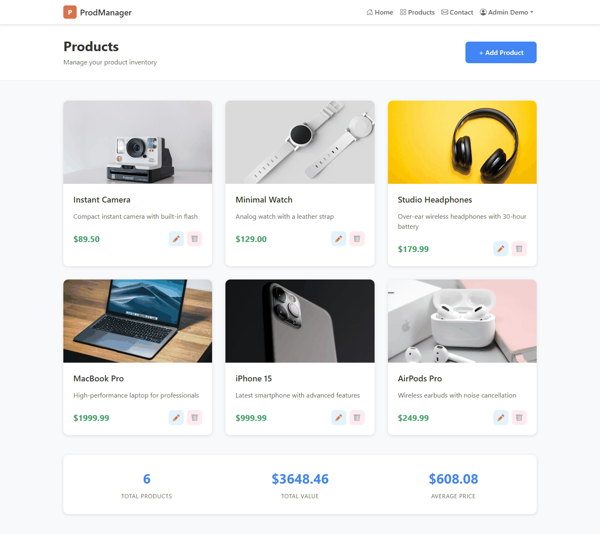
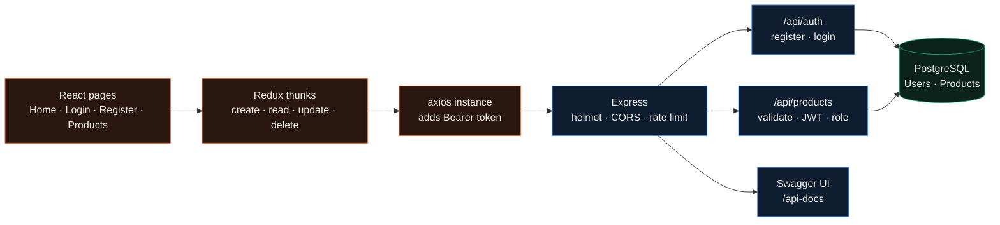
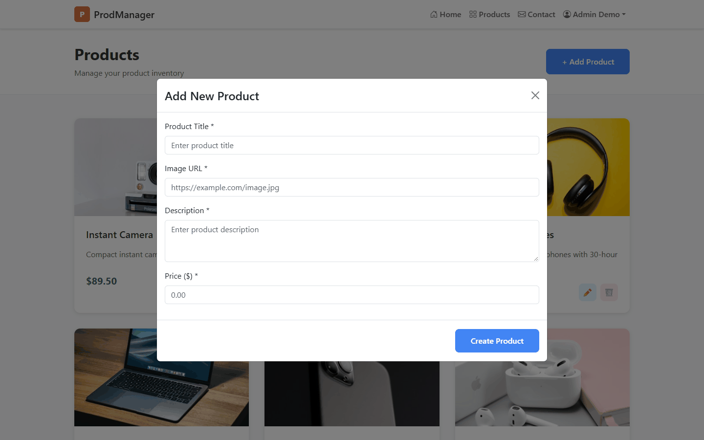
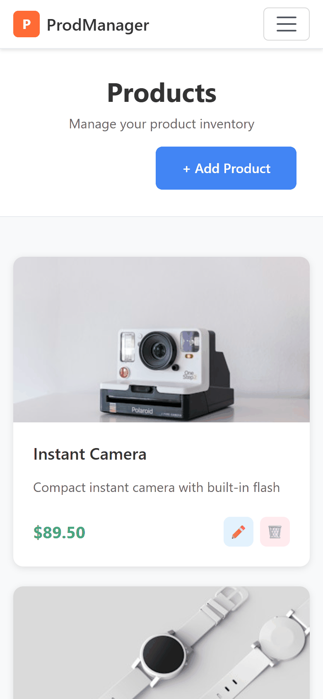

<div align="center">

# ProdManager

**A full-stack product catalogue: React and Redux in the browser, an Express API on PostgreSQL behind it, JWT logins and admin-only deletes.**




</div>

Lab work for CSCI 4177. The repo started as Lab 3 (hence the name) with a React and Redux catalogue over a small
Express API that kept products in memory. Later labs added registration, then moved the data into PostgreSQL with
Sequelize and added JWT authentication, role checks, input validation and Swagger docs. The screenshots are the app
running locally against PostgreSQL 17.

---

## How it works



Passwords are hashed with bcrypt (12 rounds) and logins return a JWT that expires after 7 days. Every request body
and query string goes through `express-validator` and an `xss` filter before it reaches a controller. The product
list supports `page`, `limit` (up to 100), `sort`, `order` and a case-insensitive `keyword` search over title and
description. When the products table is empty the server seeds three products, and `npm run seed` adds an admin account.

| Route | Who can call it |
|---|---|
| `POST /api/auth/register`, `POST /api/auth/login` | anyone |
| `GET /api/products`, `GET /api/products/:id` | anyone |
| `POST /api/products`, `PUT /api/products/:id` | any signed-in user |
| `DELETE /api/products/:id` | admin only |

Against the local run, a weak password was rejected with 400, creating a product without a token returned 401, a
normal user got 403 on delete, and the same delete as an admin returned 200.

 

## Quickstart

The backend's development config expects PostgreSQL on `localhost:5432` with the user and password in
`prodmanager-backend/config/config.json`.

```bash
createdb -U postgres prodmanager

cd prodmanager-backend
npm install
npm run migrate                  # create the tables
npm run seed                     # optional: admin account
JWT_SECRET=change-me npm start   # http://localhost:5000, Swagger UI at /api-docs

cd ../prodmanager-frontend
npm ci
npm start                        # http://localhost:3000
```

Other backend settings come from environment variables: `PORT`, `CORS_ORIGIN`, `JWT_EXPIRES_IN`,
`BCRYPT_SALT_ROUNDS`, `RATE_LIMIT_WINDOW_MS`, `RATE_LIMIT_MAX_REQUESTS`, and `DATABASE_URL` (with SSL) when
`NODE_ENV=production`. The frontend reads `REACT_APP_API_URL` (default `http://localhost:5000/api`).

## Repository map

```text
prodmanager-backend/
  server.js            Express app, security middleware, Swagger spec, startup seeding
  controllers/         auth (register, login) and product CRUD with pagination and search
  middleware/          JWT + role checks, validation and xss sanitising, error handler
  models/, migrations/ Sequelize User and Product
  seeders/             admin account
prodmanager-frontend/
  src/pages/           Home, Products, Login, Register, Contact
  src/redux/           store, actions (thunks), reducer
  src/utils/api.js     axios instance with token and 401 handling
ProdManager_API.postman_collection.json   Postman requests for the health and product routes
```

## Limitations

- Registration accepts a `role` field, so anyone can sign up as an admin. A real deployment would ignore it and
  promote accounts on the server.
- The server runs `sequelize.sync({ alter: true })` on every start, so the schema can drift from the migrations.
- The products page asks for the first page only, so the UI shows at most 10 products even though the API paginates.
- The token lives in `localStorage`, and the contact form only shows a toast; nothing is sent.
- There are no working tests. The Create React App placeholder test can't resolve `react-router-dom` 7 under Jest.

## License

MIT
